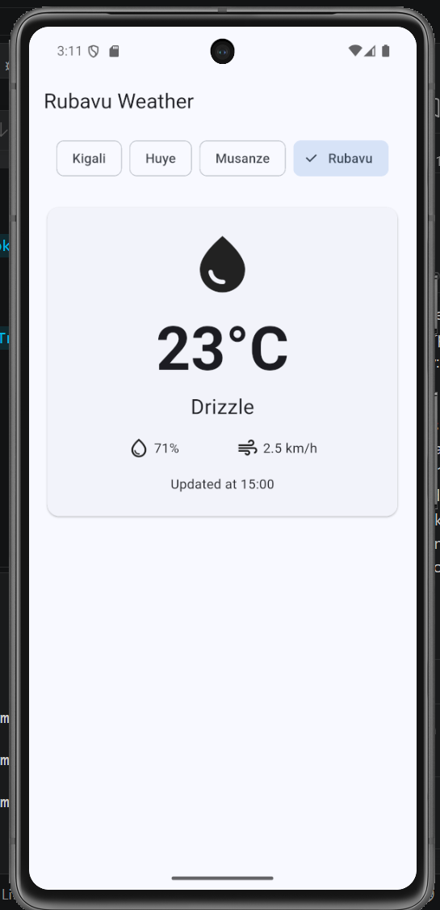
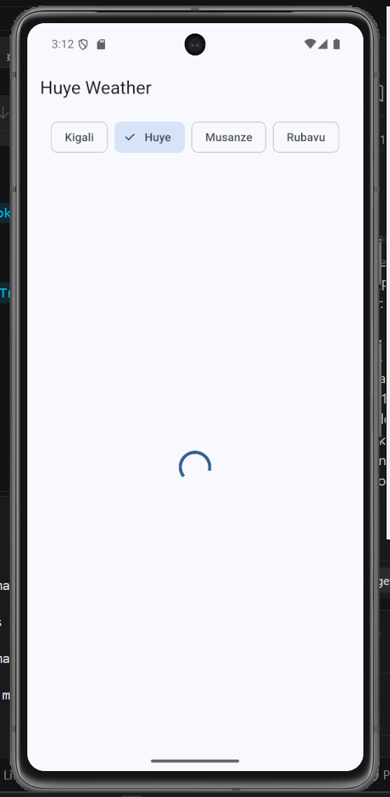
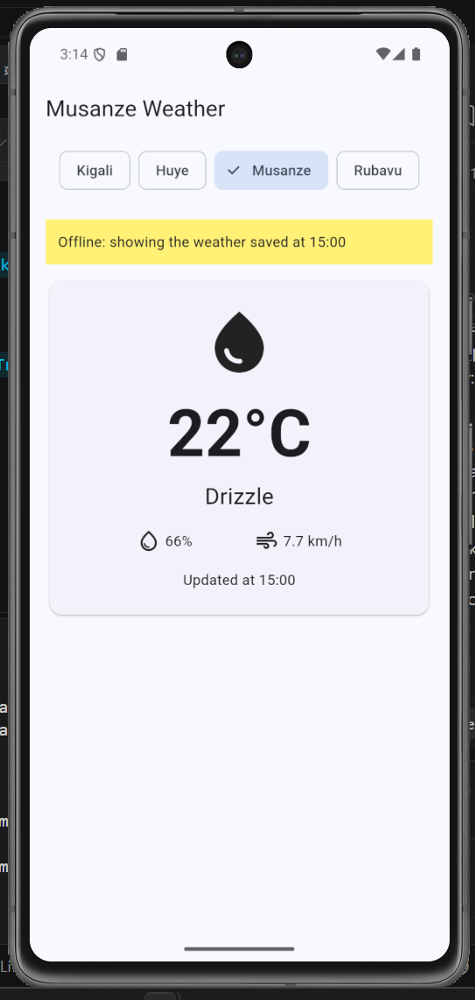
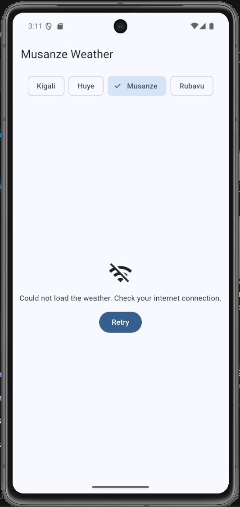

# Kigali Weather

A Flutter app that shows the current weather for four cities in Rwanda: Kigali, Huye, Musanze and Rubavu. The data comes from the free [Open-Meteo](https://open-meteo.com/) API, so no API key is needed.

## Screenshots

| Weather card | Loading | Offline, saved weather | Offline, never loaded |
|:---:|:---:|:---:|:---:|
|  |  |  |  |
| Live weather for Rubavu | The spinner while Huye loads | Musanze's last saved weather, with the yellow banner | Musanze has no saved weather, so the app shows an error and Retry |

## Features

- **Weather card:** an icon for the sky, the temperature rounded (e.g. 23°C), the sky in words (e.g. Drizzle), humidity, wind speed and the time of the reading.
- **Four cities:** chips at the top switch between Kigali, Huye, Musanze and Rubavu. The title follows the city you choose.
- **Loading, error and data states:** a spinner while the weather loads, and a clear message with a **Retry** button when there is no internet.
- **Pull to refresh:** pull the card down to reload the weather.
- **Remembers your city:** the app opens on the last city you chose, saved with `shared_preferences`.
- **Works offline:** each city's last weather is saved on the phone. With no internet, the app shows it under a yellow banner: *Offline: showing the weather saved at 15:00*.

## Project structure

```
lib/
├── main.dart      # The app, the screen (its loading, error and data states) and the weather card
└── weather.dart   # The Weather model, the cities, fetchWeather and saving to the phone
```

## Packages

- [`http`](https://pub.dev/packages/http): calls the weather API
- [`shared_preferences`](https://pub.dev/packages/shared_preferences): saves the chosen city and the last weather on the phone

## Run it

```bash
flutter pub get
flutter run
```

> After adding a plugin such as `shared_preferences`, stop the app and run it again. Hot restart cannot add a new plugin to an app that is already running.

## Try offline mode

1. Open Musanze while you are online.
2. Turn on Airplane mode and restart the app: Musanze's saved weather appears with the yellow banner.
3. Tap a city you have never opened: the error message and Retry appear.
4. Turn Airplane mode off and tap **Retry**: the live weather loads.
